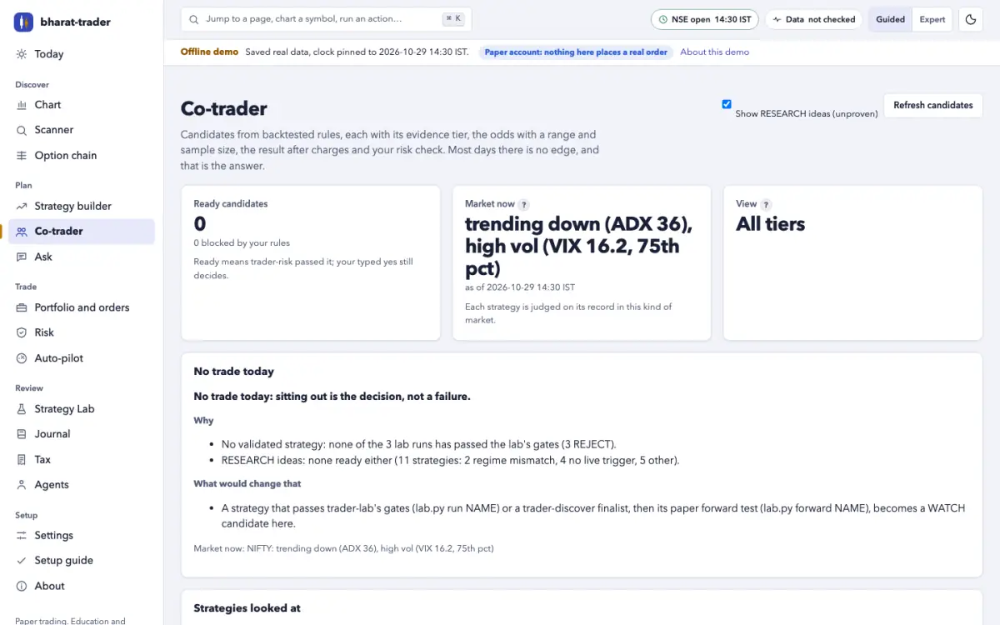
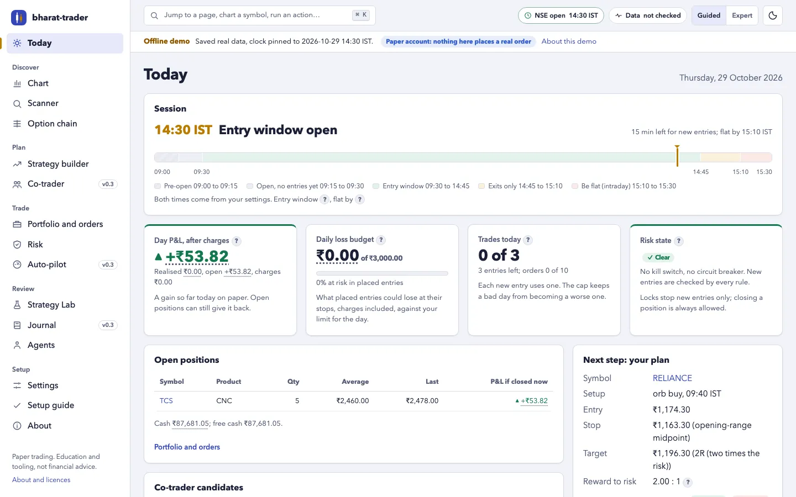
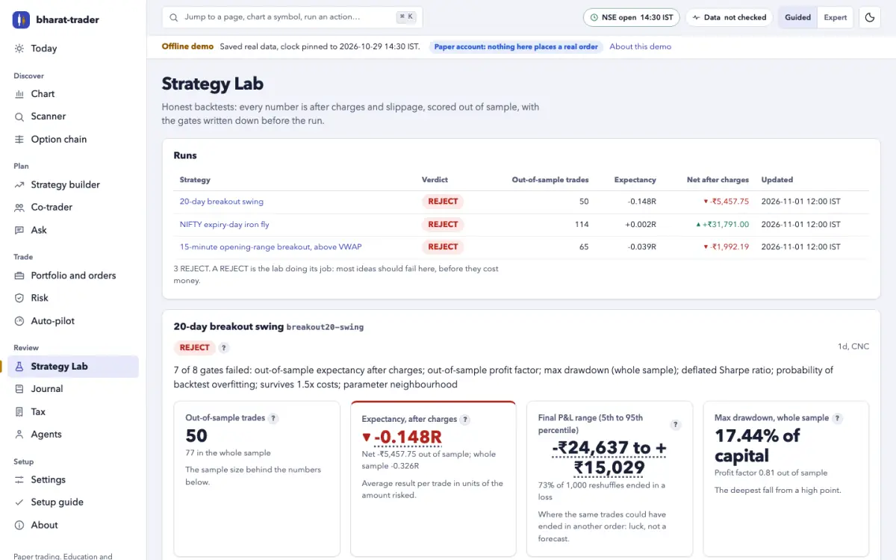
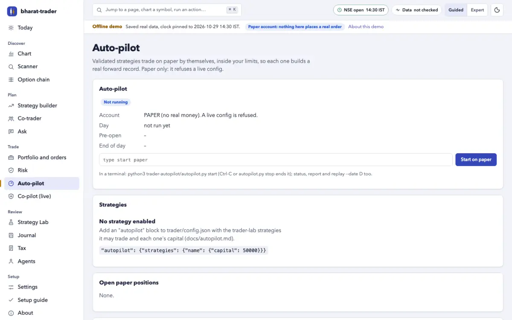
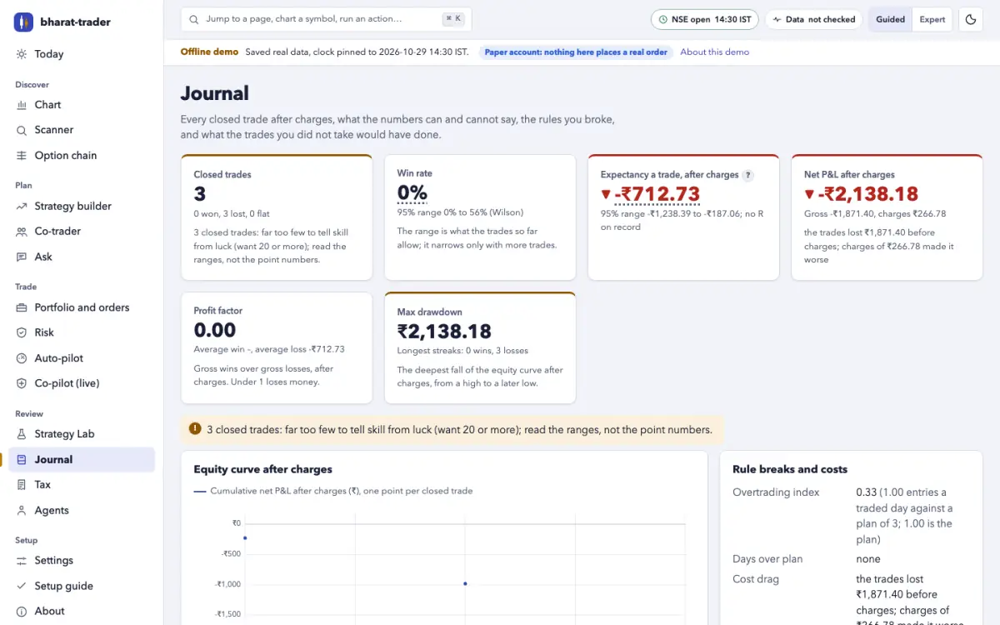
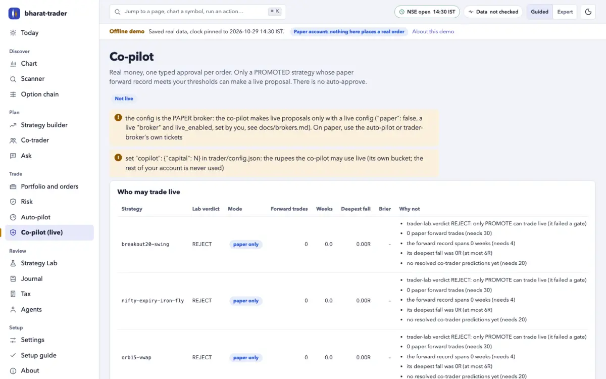
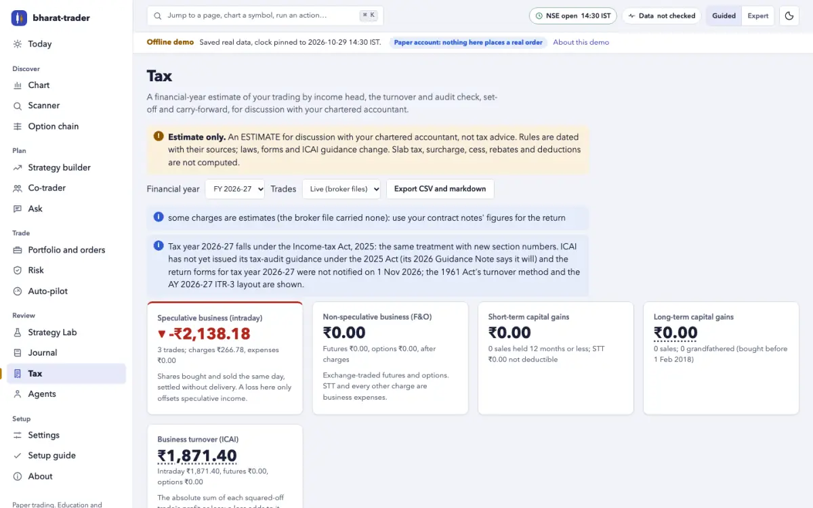
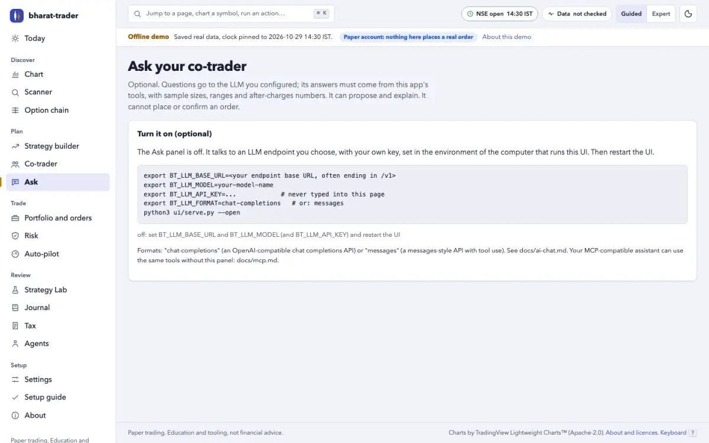
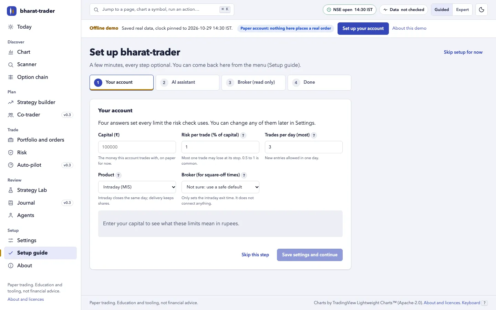

# bharat-trader

**An evidence-first co-trader for Indian markets. When there is no edge, it
tells you to sit out.**

It reads public NSE data and tests every idea after real Indian charges, out
of sample, against the luck of every rule it tried. Then it gives you today's
candidates, each with the odds that similar past trades made money, the 95%
range of those odds and the sample size behind them. Most days the honest
answer is "no trade today", and it says so plainly. Every probability it
gives is logged and later scored against what happened. Use it from the
terminal, a local web app or your own AI assistant. Nothing is ever placed
without your typed yes.

[](https://github.com/rajdavee/bharat-trader/actions/workflows/ci.yml)
[](LICENSE)




## What it found on real data (and why that is the point)

We ran everything it ships through its own tests. Nothing passed:

- **Every built-in strategy is REJECTED.** That includes the six equity
  rules (opening-range breakout, VWAP reclaim, gap fade, previous-day-high
  breakout, RSI(2), 20-day breakout swing), tested after charges on ten
  liquid NIFTY 50 stocks. It also includes the five option strategies, tested
  on 703 sessions of NSE F&O bhavcopies from January 2024 to October 2026,
  including the June 2024 election day and the April 2025 tariff fall. The
  short strangles won four or five times in six and still lost out of
  sample, because one close past the stop wiped out months of premium.
- **The expiry-day NIFTY iron fly came closest.** It passed 6 of 8 gates
  (+₹40,611 net on one lot, 12.2% a year on margin) but failed the
  out-of-sample profit factor and the deflated Sharpe ratio, so it is a
  REJECT. See the table in [docs/lab.md](docs/lab.md#options-strategies).
- **Discovery found 0 finalists.** A 500-trial search over NIFTY 50 daily
  rules on about 2.3 years of data counted all 527 trials it ran. 16
  survived validation and none survived the robustness and multiple-testing
  checks (Reality Check p = 0.84). See [docs/discovery.md](docs/discovery.md).
- **Its own early odds were too high.** On a real prediction log (38
  predictions, December 2025 to October 2026) the probabilities averaged 48%,
  and 29% of those trades made money after charges. Calibration tracking
  caught it, which is what it is for.

A tool that finds a "winning strategy" in every backtest is fitting noise.
This one reports a REJECT as loudly as a pass, counts every variant you try,
and treats "sit out" as a decision. If you build a strategy that does pass,
the same machinery tracks it on paper and demotes it when it decays.

## Why traders use it

- **Honest odds.** A rate always comes with its 95% range, its sample size,
  the market regime and the result after brokerage, STT, exchange fees,
  stamp duty and GST. "No edge" is a first-class answer.
- **Correct, and dated.** 2026 STT, the closing auction for F&O stocks, lot
  sizes from NSE's own file, the exchange's expiry calendar, your broker's
  MIS square-off. Each rule carries its effective date and source.
- **Free and local-first.** No signup, no API key, no paid data. Python 3.8+
  standard library only, nothing to `pip install`. Your data and trades stay
  on your machine.
- **Agent-native.** Twenty-three [Agent Skills](https://agentskills.io), six
  agent personas, and an [MCP](https://modelcontextprotocol.io/) server with
  55 tools and 16 prompts for any MCP-compatible AI assistant.
- **Zero-install UI.** `python3 ui/serve.py --open` opens a web app on
  `127.0.0.1` that never loads anything from the internet. It works on a
  phone too.
- **Safe by default.** Paper trading, a risk check on every order and your
  typed yes every time. The auto-pilot cannot trade live, and the live
  co-pilot sends nothing without your typed phrase for that exact order.
- **Hinglish.** Add `--lang hi-en` for tickets, risk verdicts, alerts, the
  co-trader and daily reports in Hinglish.

> **Not financial advice.** In SEBI's latest study, 87.7% of individual F&O
> traders lost money in FY26. This is software that reads public data and
> does arithmetic. Read the [fine print](#fine-print).

## The co-trader loop

```
pre-open brief ─▶ co-trader candidates ─▶ paper auto-pilot ─▶ journal ─▶ weekly review
 (regime, data)    (or "sit out")          (WATCH, PROMOTED)   (after     (calibration,
                                                                charges)   counterfactuals)
        ▲                                                                       │
        └──────────── trader-lab promotes or demotes on the forward record ◀────┘
```

1. **Pre-open brief.** The data self-test, the market regime (trending or
   ranging, the India VIX bucket, the gap, expiry and event days) and the
   co-trader's first look.
2. **Co-trader.** It only offers candidates from strategies the Strategy Lab
   validated. Each one is a full plan: size, charges, a trader-risk verdict,
   the probability with its range and n, expected R after charges, a
   time-machine second opinion, and what the evidence does NOT show.
3. **Paper auto-pilot.** Runs the loop by itself on the paper account so
   each validated strategy builds a real forward record. It refuses a live
   config.
4. **Journal.** Every closed trade after charges, the rule breaks, and a
   counterfactual ledger of what skipped and blocked trades would have done.
5. **Weekly review.** Statistics with their ranges, and whether past odds
   came true (Brier score, reliability).
6. **Promote and demote.** The lab's rules are written before the run, and
   the forward record decides. Nobody promotes a strategy by hand.
7. **Live co-pilot, PROMOTED only.** A strategy whose paper forward record
   meets your thresholds can make a live proposal. Each order is sent only
   after you type its exact phrase, then through trader-broker's six live
   gates. There is no auto-approve, and fully autonomous live trading is not
   planned ([#67](https://github.com/rajdavee/bharat-trader/issues/67)). See
   [docs/copilot.md](docs/copilot.md).

The whole routine, with prompts for your assistant, is in
[docs/cotrader-guide.md](docs/cotrader-guide.md).

## What's inside

**Research you can trust.** The **Strategy Lab** runs a strategy written as
a plain JSON spec bar by bar after Indian charges with no look-ahead. Then
come walk-forward out of sample, the parameter neighbourhood, Monte Carlo,
the deflated Sharpe ratio and the probability of backtest overfitting. Gates
written before the run give REJECT, WATCH (paper forward test) or PROMOTE.
Option strategies (strangles, condors, iron flies, spreads) are backtested
on end-of-day F&O chains. **Discovery** searches the lab's rule vocabulary
with a declared trial budget, a purged time split and an untouched holdout,
and makes every survivor beat the luck of the whole search. The **archive**
keeps years of NSE bhavcopies (equity and F&O), index closes, India VIX and
broker intraday candles on your disk, adjusted for splits and bonuses. The
**regime engine** labels every day without look-ahead. See
[lab](docs/lab.md) · [discovery](docs/discovery.md) ·
[archive](docs/archive.md) · [regime](docs/regime.md).

**The co-trader.** Today's candidates with evidence tiers (PROMOTED, WATCH,
or RESEARCH only on request and never for live). It shows the share of
similar past trades in today's regime that made money after charges, with a
Wilson range and n, shrunk toward the rule's overall rate. Candidates are
ranked per unit of risk and penalised for uncertainty and correlation. When
nothing qualifies, you get the reasons and what would change them. See
[docs/cotrader.md](docs/cotrader.md).

**Auto-pilot, on paper only.** The co-trader loop on the NSE clock, inside
per-strategy capital buckets, with trader-risk on every order and a machine
yes labelled `autopilot`. It handles stops, targets, trailing and time exits,
the MIS flat-by, F&O baskets at the close and expiry settlement, and writes
an end-of-day report. Replay any past day on a simulated clock. See
[docs/autopilot.md](docs/autopilot.md).

**Live co-pilot, one typed approval per order.** `trader-copilot` is the
bridge to real money, and slow on purpose. Only a PROMOTED strategy whose
paper forward record meets your thresholds (trades, weeks, drawdown, the
Brier score of its odds, no recent demote) can make a live proposal. It is
sized in the co-pilot's own capital bucket and checked by trader-risk on your
live config. Each one is sent only after you type its exact phrase (`yes live
BUY 42 RELIANCE`) in your terminal or the local UI (after a 10-second
countdown), then through trader-broker's six live gates. Daily caps, an
automatic live kill switch and a shadow paper twin come with it. There is no
auto-approve, and no assistant can approve. See [docs/copilot.md](docs/copilot.md).

**Market and data.** The NSE equity universe and a chart scanner; Yahoo
headlines and NSE announcements tagged for Indian events; quarterly results
from NSE XBRL filings; bulk and block deals and SEBI insider (PIT)
disclosures; alerts on the NSE calendar; and `trader-doctor`, a self-test of
every data source.

**Options and strategies.** The NSE option chain with our own Black-76 IV
and Greeks, PCR, max pain, walls, OI build-up, expected move and IV rank. A
strategy builder on the real chain shows payoff gross and after 2026 F&O
charges, the STT-on-exercise warning, margin with its method and error, and
probability of profit both from the textbook and from simulation. See
[docs/options.md](docs/options.md).

**Risk and paper trading.** PASS or BLOCK for every order (stop, max loss
with charges, daily loss, trades per day, entry window, size, cash); an F&O
basket as ONE position with Greeks and a spot x IV scenario grid;
behavioural circuit-breakers, an order-rate limit and a kill switch. The
paper broker fills shares and F&O baskets at your broker's rates with
slippage, margin, MTM and expiry settlement.

**Brokers.** Read your real Upstox, Zerodha Kite, Dhan or Angel One account
with a one-shot local login and a static-IP preflight, and check the
broker's own basket margin against our estimate. A live order is possible
only after six gates, with you running the command. Its stop and target can
go as one broker-native linked order (Kite GTT OCO, Upstox GTT, Dhan Super
Order). See [docs/brokers.md](docs/brokers.md).

**Journal and tax.** `trader-journal` keeps one entry per closed trade from
paper fills or your broker's trade book. It shows expectancy and win rate
with ranges by strategy, regime and time of day, the rule-break log and the
counterfactual ledger. `trader-tax` turns a financial year into the numbers
your CA asks for: speculative and non-speculative business income, capital
gains with the 2018 grandfathering, ICAI turnover with the audit check,
set-off, carry-forward and ITR-3 schedules, with every rule dated. It is an
estimate, not tax advice. See [journal](docs/journal.md) · [tax](docs/tax.md).

**Local web UI.** Today, Chart, Scanner, Option chain, Strategy builder,
Co-trader, Ask, Portfolio, Risk, Auto-pilot, Co-pilot, Strategy Lab, Journal, Tax,
Agents, Settings and a setup guide, grouped by the trader's day. It has a
command palette (Ctrl/Cmd-K), guided or expert detail, dark mode, a phone
layout, Hinglish, and a "why" panel for every number. See
[docs/ui.md](docs/ui.md).

**Your AI assistant.** The MCP server gives any MCP-compatible assistant 55
tools and 16 prompts: a one-call co-trader brief, the lab strategies that fit
today's regime, a strategy designer with a fixed, safe vocabulary, and
honest trial counting (every variant your assistant runs raises the bar for
its family). There is no live-order tool. You can also chat inside the web
UI with your own LLM endpoint on the optional **Ask** page. See
[mcp](docs/mcp.md) · [Ask](docs/ai-chat.md).

**Agent team.** Six personas that run the skills like a disciplined desk:
intraday trader, swing trader, options seller, researcher, risk officer and
journal coach, each with a paper scorecard after charges. See
[docs/agents.md](docs/agents.md).

## Quick start

```bash
git clone https://github.com/rajdavee/bharat-trader.git
cd bharat-trader
```

Requirements: Python 3.8 or newer. Nothing else. New here? Follow
[docs/getting-started.md](docs/getting-started.md) for your first 30
minutes, then [docs/cotrader-guide.md](docs/cotrader-guide.md) for the daily
routine.

### 1. In the terminal

The tools keep everything in a `trader/` subfolder of the folder you run them from.

```bash
python3 trader-budget/size.py init                     # your capital and risk, once
python3 trader-regime/regime.py now                    # today's market: trend, volatility, expiry, events
python3 trader-cotrader/cotrader.py today              # candidates with calibrated odds, or why to sit out
python3 trader-lab/lab.py run orb15-vwap               # does a strategy survive charges out of sample?
python3 trader-autopilot/autopilot.py start --dry-run  # the paper auto-pilot: decide and record, place nothing
python3 trader-journal/journal.py review --week last   # the weekly review
```

A trade by hand, from scan to paper ticket:

```bash
python3 trader-scanner/scan.py daily                   # pre-market setups
python3 trader-entry/entry.py check RELIANCE --setup orb --write
python3 trader-exit/exit.py plan --stop or-mid --target 2R --write
python3 trader-timemachine/timemachine.py run --write  # 10,000 replays: the honest odds
python3 trader-budget/size.py --write                  # -> trader/orders.json
python3 trader-risk/check.py                           # PASS / BLOCK
python3 trader-broker/ticket.py show                   # the paper ticket; then confirm with your yes
python3 trader-risk/check.py --lang hi-en              # the same verdicts in Hinglish
```

Prefer Hinglish? Add `--lang hi-en` to a command, or set `"lang": "hi-en"`
in `trader/config.json` (or use the toggle on the web UI's Settings page).
Numbers, ₹, IST and tickers stay the same, and the reply that places an
order is still the word *yes*. See [docs/hinglish.md](docs/hinglish.md).

<details>
<summary>Every tool, one line each</summary>

```bash
python3 trader-scanner/scan.py universe                # NSE EQ-series stocks
python3 trader-scanner/scan.py orb --at 09:45          # opening-range breakouts so far
python3 trader-news/news.py --tickers RELIANCE HDFCBANK --hours 12
python3 trader-analyst/facts.py TCS                    # last quarters from NSE filings
python3 trader-insider/insider.py deals                # today's bulk and block deals
python3 trader-alerts/alerts.py add --from-plan        # stop, target, flat by 15:10
python3 trader-risk/check.py scenarios                 # F&O Greeks and the spot x IV scenario grid
python3 trader-risk/check.py kill --reason "on tilt"   # no new entries today (unkill to lift)
python3 trader-broker/ticket.py confirm --index 1 --yes-text "yes, buy 39 TCS"
python3 trader-broker/ticket.py status                 # paper cash, positions, working legs
python3 trader-options/options.py chain NIFTY          # option chain, IV, Greeks, PCR, max pain
python3 trader-options/options.py iv NIFTY             # IV smile, skew, IV rank from India VIX
python3 trader-strategy/strategy.py build iron-condor NIFTY --wings 200 --width 100   # payoff, margin, PoP
python3 trader-strategy/strategy.py build iron-condor NIFTY --wings 200 --width 100 --orders   # as a paper proposal
python3 trader-broker/ticket.py confirm --basket --yes-text "yes"   # the strategy as ONE paper basket (after risk)
python3 trader-broker/ticket.py mtm                    # paper F&O P&L, Greeks, margin
python3 trader-lab/lab.py report orb15-vwap            # the scorecard, and what it does NOT prove
python3 trader-lab/lab.py forward orb15-vwap           # the paper forward record: promote or demote
python3 trader-discover/discover.py run --budget 500 --universe nifty50 --timeframe 1d   # search, overfitting controls on
python3 trader-cotrader/cotrader.py today --tier research   # also the unproven RESEARCH ideas, for study
python3 trader-cotrader/cotrader.py calibration        # did past probabilities come true? (Brier, reliability)
python3 trader-autopilot/autopilot.py replay --date 2026-09-21   # the auto-pilot on a past day, simulated clock
python3 trader-autopilot/autopilot.py start            # the auto-pilot loop on PAPER (status, stop, report)
python3 trader-copilot/copilot.py status               # LIVE co-pilot: who may trade live, caps (propose, approve ID)
python3 trader-broker/ticket.py holdings --broker kite # your real holdings, read only
python3 trader-broker/ticket.py preflight upstox       # static IP and today's login: ready for live?
python3 trader-doctor/doctor.py                        # is every NSE and Yahoo source answering? (exit 1 if not)
python3 trader-archive/archive.py backfill --years 3    # years of NSE EOD history on your disk, resumable
python3 trader-archive/archive.py verify                # gaps, duplicates, checksums, survivorship
python3 trader-regime/regime.py history NIFTY --from 2025-01-01   # every day's regime, stored
python3 trader-journal/journal.py sync                 # the trade journal: stats, rule breaks, after charges
python3 trader-journal/journal.py import tradebook.csv --broker zerodha   # your broker's trade book
python3 trader-tax/tax.py report --fy 2025-26          # tax estimate for your CA: heads, turnover, audit, set-off
python3 trader-tax/tax.py export --fy 2025-26          # trader/tax/FY2025-26/: report.md and CSVs
```

</details>

### 2. In your browser

```bash
python3 ui/serve.py --offline tests/fixtures/ui --open # a demo on saved real data, no network
python3 ui/serve.py --open                             # your own trader/ folder, on 127.0.0.1
```

A first run on an empty folder opens the setup guide: your capital and risk,
your assistant's MCP entry, and your broker (read only).

### 3. From your AI assistant (MCP)

Add the server to your MCP client's configuration:

```json
{
  "mcpServers": {
    "bharat-trader": {
      "command": "python3",
      "args": ["/path/to/bharat-trader/mcp/server.py", "--workdir", "/path/to/trading-folder"]
    }
  }
}
```

Restart the client. It should list 55 tools and 16 prompts. Start with the
`daily_cotrader_brief` prompt, or just ask: *"what's the best trade right
now, and how sure are we?"*, *"which of my lab strategies has an edge in
today's regime?"*, *"design an expiry-day NIFTY strategy and test it once"*,
*"stress-test my opening-range idea"*, *"review my week"*. A good answer
shows n and the range, gives numbers after charges, and is fine saying "no
trade". Try it on saved data first with
`--offline /path/to/bharat-trader/tests/fixtures/mcp`.

**As Agent Skills.** Each `trader-*` folder is a `SKILL.md` plus a script.
Copy one or all into your agent's skills folder; each works on its own:
`cp -r bharat-trader/trader-* <your-agent-skills-folder>/`.

## The skills

| skill | what it does |
| --- | --- |
| `trader-scanner` | Builds the NSE equity universe and scans every chart: 20-day breakouts, bull flags, 20-DMA reclaims, oversold bounces, and opening-range breakouts during the day. |
| `trader-news` | Yahoo headlines and NSE corporate announcements for your watchlist, tagged: results, dividend, bonus, buyback, block deal, SEBI order, pledge… |
| `trader-entry` | Watches a setup bar by bar from 09:15 and calls the moment a 5-minute bar closes above the opening range. |
| `trader-exit` | Sets the stop and target before you enter, rounded to the tick, with reward:risk before and after charges. |
| `trader-timemachine` | Replays the rest of the session 10,000 times from the stock's own last 60 days, plus every past day the setup fired. Honest odds. |
| `trader-budget` | `init` builds your risk config from your capital. Sizes each trade so the loss at the stop, charges included, fits your limit. |
| `trader-risk` | PASS or BLOCK for every order: stop, max loss, daily loss, trades per day, entry window, market hours, position size, cash; F&O baskets as one position (lots, ban list, expiry day, margin, Greeks, scenarios); circuit-breakers, order rate and a kill switch. |
| `trader-broker` | Paper broker for shares and F&O baskets: plain-language tickets, records your yes, fills with charges and slippage, margin, MTM, adjustments, expiry settlement. Reads your real Upstox, Zerodha Kite, Dhan or Angel One account; a live order (and its native linked stop and target) only after every gate. |
| `trader-alerts` | Rings on your stop, your target, the opening bell, the closing auction and your flat-by time. Knows the NSE calendar. |
| `trader-analyst` | Quarterly results straight from NSE XBRL filings: revenue, margins, profit, EPS, YoY and QoQ, in ₹ crore. |
| `trader-insider` | NSE bulk and block deals and SEBI insider-trading (PIT) disclosures, flagged when they touch stocks you hold or watch. |
| `trader-options` | NSE option chain with our own Black-76 IV and Greeks off the put-call-parity forward: PCR, max pain, call/put walls, OI build-up, straddle and expected move, IV smile and IV rank from India VIX. |
| `trader-strategy` | Strategy builder on the real chain: spreads, straddles, strangles, condors, flies, butterflies, ratios, calendars, custom legs. Payoff at expiry and today, gross and after 2026 F&O charges, breakevens, Greeks, margin with its method and error, probability of profit textbook vs simulated. |
| `trader-lab` | Strategy Lab: backtests a JSON strategy bar by bar after Indian charges, then walk-forward, parameter neighbourhood, Monte Carlo, deflated Sharpe and overfitting odds. Pre-registered gates: REJECT, WATCH (paper forward test) or PROMOTE. Six library strategies, no promises. |
| `trader-doctor` | Self-test of every data source (NSE APIs and archives, Yahoo): ok, slow, changed, down or blocked, since when, which tools it breaks and the fallback in use. Holiday-aware freshness in IST. |
| `trader-archive` | A local NSE data archive: equity and F&O bhavcopies (UDiFF and legacy), index closes, India VIX, lot sizes, ban lists, settlement prices and split/bonus factors, backfilled politely and resumably; broker intraday candles merged with Yahoo; option-chain snapshots; verify and a data-quality report. Read offline by the lab and the time machine. |
| `trader-regime` | The market regime for NIFTY, BANKNIFTY or a stock: trend or range (ADX, efficiency ratio, EMA slope, 200-day average), volatility bucket (India VIX percentile, realised vol, IV rank), gap, breadth, expiry today or tomorrow from the exchange's list, results, RBI policy and Budget days, the closing-auction window and the time of day. No look-ahead; the lab splits every backtest by it. |
| `trader-discover` | Strategy discovery with strict overfitting controls: a fixed trial budget over the lab's rule vocabulary, train / validation / untouched holdout with purging and an embargo, every trial logged and counted; deflated Sharpe with the true trial count, overfitting odds over the trial matrix, a Reality Check / SPA bootstrap, a false-discovery cut, cost stress, neighbourhood and regime checks. Survivors go to the lab as specs that still need a paper forward test. |
| `trader-cotrader` | Co-trader: today's candidates from strategies the lab validated (PROMOTED, WATCH; RESEARCH ideas only on request, never for live), each a full plan with size, charges and a trader-risk verdict; the share of past trades in today's regime that made money after charges with a Wilson / Beta 95% range and n, shrunk toward the rule's overall rate; expected R after charges; a time-machine second opinion; ranked per unit risk, penalised for uncertainty and correlation. No edge is a first-class answer. Every probability is logged and scored (Brier, log loss, reliability); overconfident rules are demoted. |
| `trader-autopilot` | Auto-pilot on PAPER only: the co-trader loop on the NSE clock (pre-open brief, PROMOTED and WATCH candidates in per-strategy capital buckets, trader-risk and a machine yes labelled autopilot, stops, targets, trailing and time exits, flat-by, F&O baskets at the close and expiry), then the journal hook, calibration, the lab's forward record and promote or demote, and a daily report. Resumable, one loop per folder, kill switch aware; replays any past day on a simulated clock. Refuses a live config. |
| `trader-copilot` | Live co-pilot: LIVE proposals only for PROMOTED strategies whose paper forward record meets your thresholds (trades, weeks, drawdown in R, Brier score, no recent demote), sized in its own live bucket, trader-risk PASS on the live config, a plain live ticket (max loss with charges, linked exits, evidence and calibration, broker margin), and your exact typed phrase per order (terminal, or the UI after a 10-second countdown) before trader-broker's six gates. Daily caps, automatic live kill with flatten tickets, cool-off, expiry and price-move invalidation, shadow paper twin. No auto-approve. |
| `trader-journal` | The trade journal: one entry per closed trade (an F&O strategy as one entry) from paper fills, your live trade book and Zerodha, Upstox, Dhan, Angel One or Groww tradebook imports, with persona, strategy, regime, R multiple, MAE/MFE and your notes; expectancy and win rate with intervals by strategy, persona, regime and time of day; rule breaks, overtrading and cost drag; a counterfactual ledger of every skipped or blocked trade; the weekly review. |
| `trader-tax` | A financial-year tax estimate for your CA: intraday equity as speculative business income, F&O as non-speculative, delivery shares as short- or long-term capital gains (s.111A, s.112A, the 31 Jan 2018 grandfathering); charges per head; F&O and intraday turnover the ICAI way with the audit check; set-off and carry-forward; special-rate amounts, advance-tax dates and ITR-3 schedules; FY 2025-26 under the 1961 Act, tax year 2026-27 under the 2025 Act; CSV and markdown export. Not tax advice. |

## How it compares

Free option chains and payoff charts are table stakes now. What is rare is
all of these together, run on your own machine:

| | after-charges payoff | honest-odds simulation | out-of-sample lab | calibrated odds, sit-out answer | multi-broker paper F&O | local-first | MCP | dated rules |
| --- | :---: | :---: | :---: | :---: | :---: | :---: | :---: | :---: |
| **bharat-trader** | ✅ every leg, with STT on exercise | ✅ textbook vs bootstrap, IV shifts, EV and tail | ✅ walk-forward, deflated Sharpe, overfitting odds, pre-registered gates, equity and options | ✅ range and n on every rate, Brier and reliability tracked, "no trade today" | ✅ Upstox, Kite, Dhan, Angel, Groww charge profiles | ✅ 127.0.0.1, no account | ✅ 55 tools, 16 prompts | ✅ effective date and source per rule |
| Typical free option-analytics apps | ◐ often gross only | ◐ one model-based PoP | — | — | ◐ one broker, forward only | — hosted, broker login | — rarely | ◐ |
| Typical paid backtesting platforms | ◐ often | ◐ | ◐ backtests, rarely overfitting statistics | — rarely | ◐ their own simulator | — hosted, your strategies on their servers | — rarely | ◐ |
| Typical open-source NSE toolkits | ◐ | — rarely | — rarely | — rarely | ◐ a few, often needing a live broker session | ✅ | ◐ some | — rarely |

✅ yes · ◐ partly, or varies by product · — usually not. These are
categories, not products, written from public feature pages, documentation
and user forums read in October and November 2026. Individual products
differ, and some do things this table does not credit. If a cell is wrong
for a whole category, please [open an issue](https://github.com/rajdavee/bharat-trader/issues).

Where others are ahead, honestly:

- Paid platforms have years of **intraday** historical option chains. Here
  option backtests use end-of-day bhavcopies, so a stop is seen only at the
  close. An intraday chain archive is on the [v0.4 list](docs/roadmap.md).
- Broker apps have real-time data and one-tap execution. Here the data is
  free, delayed and unofficial, and live orders are deliberately hard.
- Mobile apps have push notifications and polish.

## Screenshots

From `python3 ui/serve.py --offline tests/fixtures/ui` on saved NSE and
Yahoo data of 29 and 30 October 2026, with `cotrader.py today` run on the
repository's real lab fixtures.

| | |
| --- | --- |
|  |  |
| **Today**, the cockpit | **Strategy Lab**: three REJECTs, and why |
|  |  |
| **Auto-pilot**, paper only | **Journal** with ranges, not just point numbers |
|  |  |
| **Co-pilot**: who may trade live, and why not | **Chart** with the plan's levels |
|  |  |
| **Tax** estimate for your CA | **Ask**, your own LLM, off by default |
|  |  |
| **Strategy builder** | **Setup guide** on a fresh folder |

More in [docs/ui.md](docs/ui.md#screenshots): dark mode, a phone, the
option chain and the risk panel.

## A trading day

```
08:45  pre-open      doctor · archive update · regime · co-trader brief     sit out, or a short list
09:15  open          entry watch                                           opening range forms (09:15–09:30)
09:30  entries open  candidate → explain → budget → risk → broker (your yes); the auto-pilot on paper
       in trade      alerts: stop · target · flat-by
15:10  flat-by       broker flatten                                        before MIS auto square-off (earlier with broker_profile)
15:15  F&O stocks    closing auction to 15:35                              continuous trading ends (15:30 from 7 Dec 2026)
15:30  close         journal sync · auto-pilot report · calibration
weekend              weekly review · lab forward: promote or demote
```

## Documentation

Start at [docs/README.md](docs/README.md). The main pages:
[getting started](docs/getting-started.md) ·
[co-trader guide](docs/cotrader-guide.md) ·
[co-trader method](docs/cotrader.md) ·
[auto-pilot](docs/autopilot.md) ·
[live co-pilot](docs/copilot.md) ·
[Strategy Lab](docs/lab.md) ·
[discovery](docs/discovery.md) ·
[archive](docs/archive.md) ·
[regime](docs/regime.md) ·
[journal](docs/journal.md) ·
[tax](docs/tax.md) ·
[options and strategies](docs/options.md) ·
[brokers](docs/brokers.md) ·
[configuration and charges](docs/configuration.md) ·
[web UI](docs/ui.md) ·
[MCP server](docs/mcp.md) ·
[Ask panel (your own LLM)](docs/ai-chat.md) ·
[agent team](docs/agents.md) ·
[Hinglish output](docs/hinglish.md) ·
[architecture](docs/architecture.md) ·
[data sources](docs/data-sources.md) ·
[roadmap](docs/roadmap.md).

## Tests

```bash
python3 -m unittest discover -s tests -v
```

The suite runs offline on fixtures cut from real NSE and Yahoo data, on
Python 3.8–3.13, Linux, macOS and Windows. It also checks that every command
in these docs parses and every link resolves.

## Roadmap

v0.3.0 made it a co-trader: the local data archive, the regime engine,
strategy discovery, options backtests in the lab, calibrated candidates,
the paper auto-pilot, the journal and counterfactual ledger, the tax
estimate, native linked exits and Angel One, assistant workflow tools with
honest trial counting, the redesigned UI and Hinglish. Ideas for v0.4 include
an intraday option-chain archive for intraday options backtests, more
brokers, mobile notifications, community strategy specs shared with
lab-verified scorecards, and speed. See [docs/roadmap.md](docs/roadmap.md).

Ideas and pull requests welcome. Start with [CONTRIBUTING.md](CONTRIBUTING.md).

## Fine print

**Not financial advice.** This software does not know your situation and
cannot see the future. Decide for yourself, and consult a SEBI-registered
investment adviser if you need advice.

**Most traders lose money, and F&O is worse.** SEBI's study of individual
equity-derivatives traders (released 20 August 2026) found that 87.7% made a
net loss in FY26, about ₹91,685 crore in all, and that options were 92% of
those losses ([Business Today, 21 Aug 2026](https://www.businesstoday.in/markets/story/rs91685-cr-lost-88-of-individual-traders-lost-money-in-fy26-options-drove-92-of-losses-550474-2026-08-21)).
For FY25 the figure was 91%, ₹1,05,603 crore
([Business Standard, 7 Jul 2025](https://www.business-standard.com/markets/news/net-losses-of-traders-in-fo-widens-in-fy25-sebi-study-125070701221_1.html)).
In the cash market, over 70% of individual intraday traders lost money in
FY23 ([Business Standard, 24 Jul 2024](https://www.business-standard.com/markets/news/over-70-intra-day-traders-incur-losses-during-fy23-reveals-sebi-study-124072401110_1.html)).

**The auto-pilot is paper only.** It refuses a live config, checked in
code before every step, and its machine yes can never send a live order.
Live orders go through the co-pilot (or `ticket.py place` by hand), one typed
approval per order.

**Nothing is placed without your yes.** Only `trader-broker` can lead to an
order, only after `trader-risk` passes that exact order, and only after you
type yes. Paper is the default. A live order at Upstox, Zerodha Kite, Dhan or Angel One
also needs `"paper": false`, `live_enabled` for that broker, a passed
static-IP preflight today, and you running `ticket.py place` yourself.

**Live API orders need a static IP and a daily login.** Under SEBI's
retail-algo framework (circular of 4 February 2025, fully in force from
1 April 2026), brokers accept API orders only from a static IP you have
registered with them, after a two-factor login every trading day, and at
most 10 orders a second without registering an algo. Reading your account
works from any IP. This tool sends at most 3 orders a second by default and
never more than 9. See [docs/brokers.md](docs/brokers.md).

**STT on exercise.** Since 1 April 2026, an in-the-money option you hold to
expiry is exercised and pays STT of 0.15% of its whole intrinsic value, even
when the trade lost money; selling it before 15:30 on expiry day pays 0.15%
of the premium instead. `trader-strategy` warns you, leg by leg. Stock
options are settled by delivery: hold one into expiry and you take or give
the shares.

**Margin numbers are estimates.** Margin required is a SPAN-style estimate
with a stated error (+/-15% for index options, +/-35% for stock options),
checked against NSE's SPAN file on one day. The max loss at expiry is exact
and is not the margin. Check your broker's basket margin before any real order.

**Probabilities are models.** The textbook probability assumes a lognormal
market at today's IV; the simulated one replays the underlying's own past.
The co-trader's probability is the share of similar past trades that made
money after charges, with its range and sample size: it is not the chance
that today's trade wins. None of them is a forecast, and when they disagree,
that is information. Every co-trader probability is logged and scored, and
the scores so far say the early odds were too high.

**The Time Machine and the Strategy Lab are simulations, not predictions.**
They are built from past bars. Results days, circuit limits, news and expiry
can do things those days never did, and a lab pass is evidence, not a
guarantee.

**A stop is a plan, not a guarantee.** Gaps, circuits and fast markets can
fill a stop well past its price, and NSE's closing auction has no stop-loss orders.

**The data is free and unofficial.** Yahoo Finance's chart endpoint is not an
official API, and NSE's website APIs can change or rate-limit without notice
(`trader-doctor` tells you when). Check anything that matters against your
broker before you act.

**Charges are estimates.** Defaults model a typical discount broker, with
dated statutory rates. Set your broker's actual rates in `trader/config.json`.

**Insider and bulk-deal data are public disclosures, not inside information.**
SEBI's PIT Regulations require them to be disclosed; this tool reads what is
already public.

**Taxes.** Intraday equity profits are generally speculative business income
in India and F&O profits non-speculative business income. `trader-tax` gives
an estimate with every rule dated and sourced, to discuss with your CA.
Nothing here is tax advice.

## License

[MIT](LICENSE) © Raj Dave and bharat-trader contributors.

Not affiliated with NSE, BSE, SEBI, Yahoo or any broker. See [NOTICE](NOTICE).
