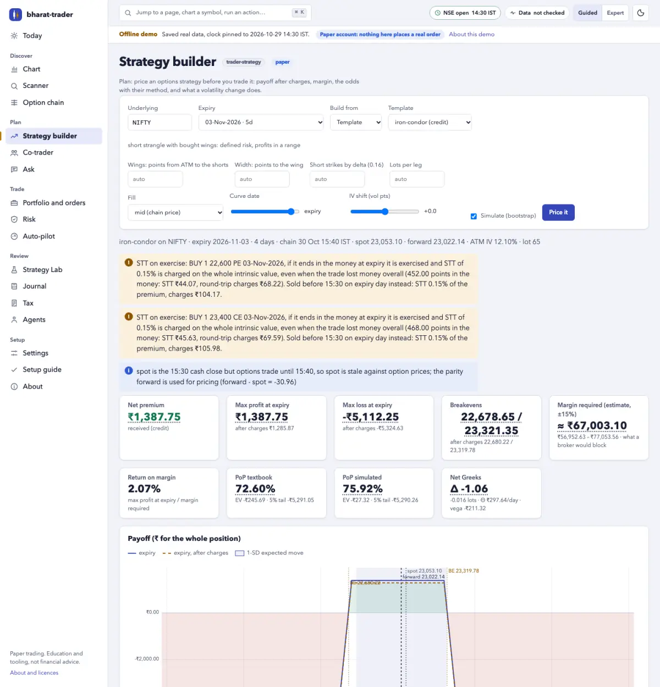
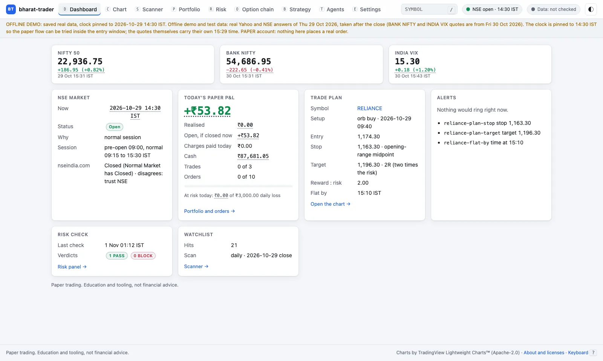
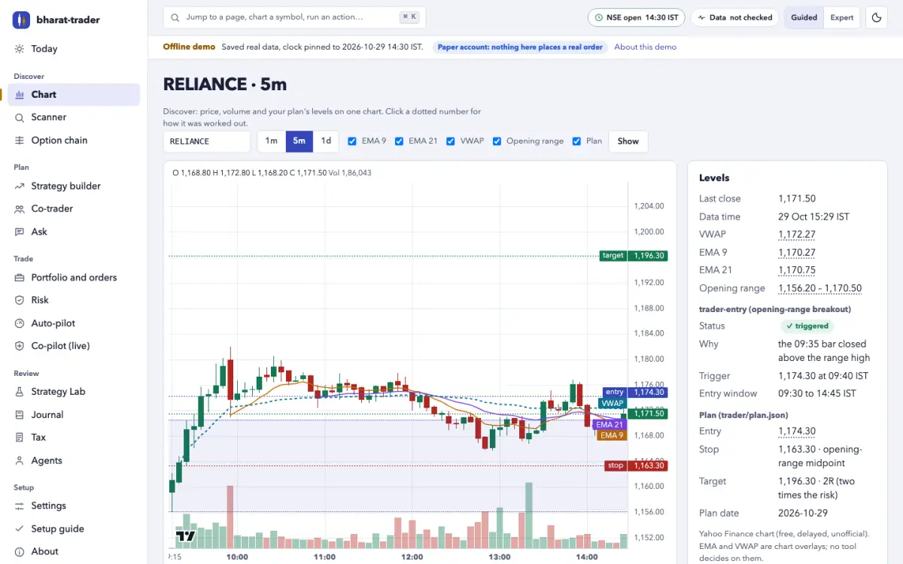
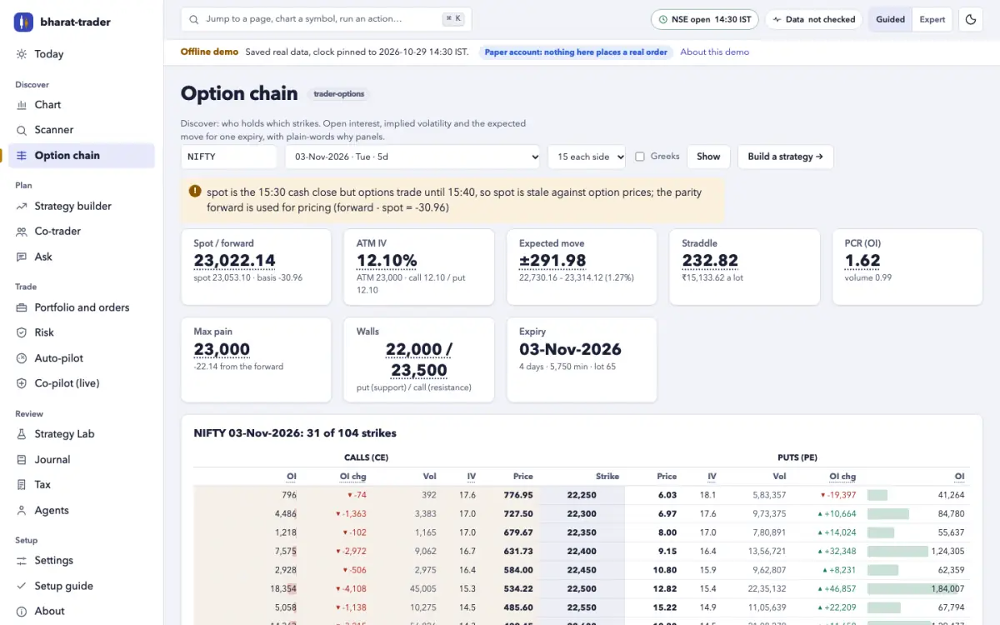
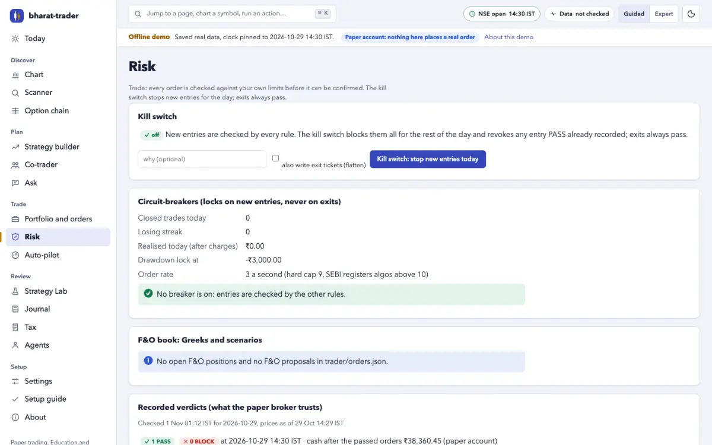

# bharat-trader

**The most correct, honest, local-first trading toolkit for Indian markets.**
Scan NSE, read the filings, plan the trade, test the odds after real Indian
charges, build option strategies on the live chain, find out whether a
strategy really has an edge, and paper-trade it at your broker's rates.
From the terminal, a local web app or your own AI assistant. Nothing is ever
placed without your yes.

[](https://github.com/rajdavee/bharat-trader/actions/workflows/ci.yml)
[](LICENSE)


- **Free.** No signup, no API key, no paid data. Public NSE data and Yahoo Finance.
- **Correct, and dated.** 2026 STT, the closing auction for F&O stocks, lot
  sizes from NSE's own file, the expiry calendar from the exchange, your
  broker's MIS square-off: each rule carries its effective date and source.
- **Honest.** Every payoff, probability and backtest is shown gross *and*
  after brokerage, STT, exchange fees, stamp duty and GST. Textbook odds sit
  next to simulated ones. The Strategy Lab rejects most strategies, and says why.
- **Standard library only.** Python 3.8+, nothing to `pip install`, every tool runs by hand.
- **Agent-native.** Fifteen [Agent Skills](https://agentskills.io), six agent
  personas, and an [MCP](https://modelcontextprotocol.io/) server with 32 tools
  for any MCP-compatible AI assistant.
- **Zero-install UI.** `python3 ui/serve.py --open`: a web app on `127.0.0.1`
  that never loads anything from the internet.
- **Safe by default.** Paper trading. A risk check on every order. Your typed yes, every time.

> **Not financial advice.** In SEBI's latest study, 87.7% of individual F&O
> traders lost money in FY26. This is software that reads public data and
> does arithmetic. Read the [fine print](#fine-print).



## What's inside

**Market and data.** The NSE equity universe and a chart scanner (20-day
breakouts, bull flags, 20-DMA reclaims, oversold bounces, opening-range
breakouts during the day); Yahoo headlines and NSE announcements tagged for
Indian events; quarterly results straight from NSE XBRL filings; bulk and
block deals and SEBI insider (PIT) disclosures; alerts on the NSE calendar;
`trader-doctor`, a self-test of every data source with since-when history
and the fallback in use; and `trader-archive`, years of NSE bhavcopies (equity
and F&O), index closes, India VIX and broker intraday candles on your own
disk, split- and bonus-adjusted, read offline by the lab and the time machine.

**Options and strategies.** The NSE option chain with our own Black-76 IV and
Greeks off the put-call-parity forward, PCR, max pain, call and put walls,
OI build-up, the straddle and expected move, the IV smile and IV rank from
India VIX. A strategy builder on the real chain (spreads, straddles,
strangles, condors, flies, butterflies, ratios, calendars, custom legs) with
payoff at expiry and today, gross and after 2026 F&O charges, the
STT-on-exercise warning, margin required with its method and error, and
probability of profit textbook vs simulated. See [docs/options.md](docs/options.md).

**Strategy Lab.** Strategies as plain JSON specs, backtested bar by bar with
no look-ahead after Indian charges, then walk-forward out of sample, the
parameter neighbourhood, Monte Carlo, the deflated Sharpe ratio and the
probability of backtest overfitting. Gates written before the run give
REJECT, WATCH (paper forward test) or PROMOTE, with automatic DEMOTE when the
forward record decays. See [docs/lab.md](docs/lab.md).

**Risk and paper trading.** PASS or BLOCK for every order: stop, max loss
with charges, daily loss, trades per day, entry window, position size and
cash; an F&O basket as ONE position (lots, ban list, expiry day, premium,
margin, portfolio Greeks and a spot x IV scenario grid); behavioural
circuit-breakers, an order-rate limit and a kill switch. The paper broker
fills shares and F&O baskets (one ticket, one yes, all legs or none) with
spread-based slippage, market protection, price bands and your broker's
brokerage, blocks margin, marks to market and settles at expiry.

**Brokers.** Read your real Upstox, Zerodha Kite or Dhan account (funds,
holdings, positions, orders, instruments) with a one-shot local login and
a static-IP preflight. A live order is possible only after six gates and you
running the command yourself. See [docs/brokers.md](docs/brokers.md).

**Local web UI.** Dashboard, candlestick charts with your plan's levels,
scanner, option chain, strategy builder, paper portfolio with F&O by
strategy, the risk panel and kill switch, the agent team and a validated
settings editor. A "why" panel explains every number. See [docs/ui.md](docs/ui.md).

**Your AI assistant, via MCP.** 32 tools and 11 prompts for any
MCP-compatible assistant, over stdio or loopback HTTP. Paper only: there is
no live-order tool at all. See [docs/mcp.md](docs/mcp.md).

**Agent team.** Six personas that run the skills like a disciplined desk:
intraday trader, swing trader, options seller, researcher, risk officer and
journal coach, each with a paper scorecard after charges. See [docs/agents.md](docs/agents.md).

## Quick start

```bash
git clone https://github.com/rajdavee/bharat-trader.git
cd bharat-trader
```

Requirements: Python 3.8 or newer. Nothing else. New here? Follow
[docs/getting-started.md](docs/getting-started.md): your first 30 minutes,
step by step.

### 1. In the terminal

The tools keep everything in a `trader/` subfolder of the folder you run them from.

```bash
python3 trader-budget/size.py init                     # your capital and risk, once
python3 trader-scanner/scan.py daily                   # pre-market setups
python3 trader-entry/entry.py check RELIANCE --setup orb --write
python3 trader-exit/exit.py plan --stop or-mid --target 2R --write
python3 trader-timemachine/timemachine.py run --write  # 10,000 replays: the honest odds
python3 trader-budget/size.py --write                  # -> trader/orders.json
python3 trader-risk/check.py                           # PASS / BLOCK
python3 trader-broker/ticket.py show                   # the paper ticket; then confirm with your yes
```

<details>
<summary>Every tool, one line each</summary>

```bash
python3 trader-scanner/scan.py universe                # NSE EQ-series stocks
python3 trader-scanner/scan.py orb --at 09:45          # opening-range breakouts so far
python3 trader-news/news.py --tickers RELIANCE HDFCBANK --hours 12
python3 trader-analyst/facts.py TCS                    # last quarters from NSE filings
python3 trader-insider/insider.py deals                # today's bulk and block deals
python3 trader-alerts/alerts.py add --from-plan        # stop, target, flat by 15:10
python3 trader-risk/check.py scenarios                 # F&O Greeks and the spot x IV scenario grid
python3 trader-risk/check.py kill --reason "on tilt"   # no new entries today (unkill to lift)
python3 trader-broker/ticket.py confirm --index 1 --yes-text "yes, buy 39 TCS"
python3 trader-broker/ticket.py status                 # paper cash, positions, working legs
python3 trader-options/options.py chain NIFTY          # option chain, IV, Greeks, PCR, max pain
python3 trader-options/options.py iv NIFTY             # IV smile, skew, IV rank from India VIX
python3 trader-strategy/strategy.py build iron-condor NIFTY --wings 200 --width 100   # payoff, margin, PoP
python3 trader-strategy/strategy.py build iron-condor NIFTY --wings 200 --width 100 --orders   # as a paper proposal
python3 trader-broker/ticket.py confirm --basket --yes-text "yes"   # the strategy as ONE paper basket (after risk)
python3 trader-broker/ticket.py mtm                    # paper F&O P&L, Greeks, margin
python3 trader-lab/lab.py run orb15-vwap               # backtest + robustness + gates, after charges
python3 trader-lab/lab.py report orb15-vwap            # the scorecard, and what it does NOT prove
python3 trader-broker/ticket.py holdings --broker kite # your real holdings, read only
python3 trader-broker/ticket.py preflight upstox       # static IP and today's login: ready for live?
python3 trader-doctor/doctor.py                        # is every NSE and Yahoo source answering? (exit 1 if not)
python3 trader-archive/archive.py backfill --years 3    # years of NSE EOD history on your disk, resumable
python3 trader-archive/archive.py verify                # gaps, duplicates, checksums, survivorship
```

</details>

### 2. In your browser

```bash
python3 ui/serve.py --offline tests/fixtures/ui --open # a demo on saved real data, no network
python3 ui/serve.py --open                             # your own trader/ folder, on 127.0.0.1
```

### 3. From your AI assistant (MCP)

Add the server to your MCP client's configuration:

```json
{
  "mcpServers": {
    "bharat-trader": {
      "command": "python3",
      "args": ["/path/to/bharat-trader/mcp/server.py", "--workdir", "/path/to/trading-folder"]
    }
  }
}
```

Then just ask: *"scan NSE for breakouts"*, *"any news on Reliance?"*, *"plan
my exit for HDFCBANK"*, *"how many shares can I buy with ₹1,000 risk?"*,
*"build an iron condor on NIFTY and tell me the margin and the real odds"*,
*"does the opening-range breakout really work after charges?"*. Try it on
saved data first with `--offline /path/to/bharat-trader/tests/fixtures/mcp`.

**As Agent Skills.** Each `trader-*` folder is a `SKILL.md` plus a script.
Copy one or all into your agent's skills folder; each works on its own:
`cp -r bharat-trader/trader-* <your-agent-skills-folder>/`.

## The skills

| skill | what it does |
| --- | --- |
| `trader-scanner` | Builds the NSE equity universe and scans every chart: 20-day breakouts, bull flags, 20-DMA reclaims, oversold bounces, and opening-range breakouts during the day. |
| `trader-news` | Yahoo headlines and NSE corporate announcements for your watchlist, tagged: results, dividend, bonus, buyback, block deal, SEBI order, pledge… |
| `trader-entry` | Watches a setup bar by bar from 09:15 and calls the moment a 5-minute bar closes above the opening range. |
| `trader-exit` | Sets the stop and target before you enter, rounded to the tick, with reward:risk before and after charges. |
| `trader-timemachine` | Replays the rest of the session 10,000 times from the stock's own last 60 days, plus every past day the setup fired. Honest odds. |
| `trader-budget` | `init` builds your risk config from your capital. Sizes each trade so the loss at the stop, charges included, fits your limit. |
| `trader-risk` | PASS or BLOCK for every order: stop, max loss, daily loss, trades per day, entry window, market hours, position size, cash; F&O baskets as one position (lots, ban list, expiry day, margin, Greeks, scenarios); circuit-breakers, order rate and a kill switch. |
| `trader-broker` | Paper broker for shares and F&O baskets: plain-language tickets, records your yes, fills with charges and slippage, margin, MTM, adjustments, expiry settlement. Reads your real Upstox, Zerodha Kite or Dhan account; a live order only after every gate. |
| `trader-alerts` | Rings on your stop, your target, the opening bell, the closing auction and your flat-by time. Knows the NSE calendar. |
| `trader-analyst` | Quarterly results straight from NSE XBRL filings: revenue, margins, profit, EPS, YoY and QoQ, in ₹ crore. |
| `trader-insider` | NSE bulk and block deals and SEBI insider-trading (PIT) disclosures, flagged when they touch stocks you hold or watch. |
| `trader-options` | NSE option chain with our own Black-76 IV and Greeks off the put-call-parity forward: PCR, max pain, call/put walls, OI build-up, straddle and expected move, IV smile and IV rank from India VIX. |
| `trader-strategy` | Strategy builder on the real chain: spreads, straddles, strangles, condors, flies, butterflies, ratios, calendars, custom legs. Payoff at expiry and today, gross and after 2026 F&O charges, breakevens, Greeks, margin with its method and error, probability of profit textbook vs simulated. |
| `trader-lab` | Strategy Lab: backtests a JSON strategy bar by bar after Indian charges, then walk-forward, parameter neighbourhood, Monte Carlo, deflated Sharpe and overfitting odds. Pre-registered gates: REJECT, WATCH (paper forward test) or PROMOTE. Six library strategies, no promises. |
| `trader-doctor` | Self-test of every data source (NSE APIs and archives, Yahoo): ok, slow, changed, down or blocked, since when, which tools it breaks and the fallback in use. Holiday-aware freshness in IST. |
| `trader-archive` | A local NSE data archive: equity and F&O bhavcopies (UDiFF and legacy), index closes, India VIX, lot sizes, ban lists, settlement prices and split/bonus factors, backfilled politely and resumably; broker intraday candles merged with Yahoo; option-chain snapshots; verify and a data-quality report. Read offline by the lab and the time machine. |

## How it compares

Free option chains and payoff charts are table stakes now. What is rare is
all of these together, run on your own machine:

| | after-charges payoff | honest-odds simulation | out-of-sample lab | multi-broker paper F&O | local-first | MCP | dated rules |
| --- | :---: | :---: | :---: | :---: | :---: | :---: | :---: |
| **bharat-trader** | ✅ every leg, with STT on exercise | ✅ textbook vs bootstrap, IV shifts, EV and tail | ✅ walk-forward, deflated Sharpe, overfitting odds, pre-registered gates | ✅ Upstox, Kite, Dhan, Angel, Groww charge profiles | ✅ 127.0.0.1, no account | ✅ 32 tools | ✅ effective date and source per rule |
| Typical free option-analytics apps | ◐ often gross only | ◐ one model-based PoP | — | ◐ one broker, forward only | — hosted, broker login | — rarely | ◐ |
| Typical paid backtesting platforms | ◐ often | ◐ | ◐ backtests, rarely overfitting statistics | ◐ their own simulator | — hosted, your strategies on their servers | — rarely | ◐ |
| Typical open-source NSE toolkits | ◐ | — rarely | — rarely | ◐ a few, often needing a live broker session | ✅ | ◐ some | — rarely |

✅ yes · ◐ partly, or varies by product · — usually not. Categories, not
products: written from public feature pages, documentation and user forums
read in October and November 2026. Individual products differ, and some do
things this table does not credit; if one of these cells is wrong for a whole
category, please [open an issue](https://github.com/rajdavee/bharat-trader/issues).

Where others are ahead, honestly: paid platforms have years of historical
option chains for multi-leg backtests (here the Strategy Lab tests equity
rules; options replay is [v0.3](docs/roadmap.md)); broker apps have real-time
data and one-tap execution (here the data is free, delayed and unofficial,
and live orders are deliberately hard); and polished mobile apps.

## Screenshots

From `python3 ui/serve.py --offline tests/fixtures/ui`, on saved NSE and
Yahoo data of 29 and 30 October 2026.

| | |
| --- | --- |
|  |  |
| **Dashboard** | **Chart** with the plan's levels |
|  |  |
| **Option chain** | **Risk panel** with the kill switch |

## A trading day

```
09:00  pre-open      scanner daily · news · insider        build the watchlist
09:15  open          entry watch                            opening range forms (09:15–09:30)
09:30  entries open  entry triggers → exit → timemachine → budget → risk → broker (your yes)
       in trade      alerts: stop · target · flat-by
15:10  flat-by       broker flatten                         before MIS auto square-off (earlier with broker_profile)
15:15  F&O stocks    closing auction to 15:35                continuous trading ends (15:30 from 7 Dec 2026)
15:30  close
```

## Documentation

Start at [docs/README.md](docs/README.md). The main pages:
[getting started](docs/getting-started.md) ·
[architecture](docs/architecture.md) ·
[configuration and charges](docs/configuration.md) ·
[options and strategies](docs/options.md) ·
[Strategy Lab](docs/lab.md) ·
[brokers](docs/brokers.md) ·
[web UI](docs/ui.md) ·
[MCP server](docs/mcp.md) ·
[agent team](docs/agents.md) ·
[data sources](docs/data-sources.md) ·
[roadmap](docs/roadmap.md).

## Tests

```bash
python3 -m unittest discover -s tests -v
```

The suite runs offline on fixtures cut from real NSE and Yahoo data, on
Python 3.8–3.13, Linux, macOS and Windows. It also checks that every command
in these docs parses and every link resolves.

## Roadmap

v0.2.0 brought F&O analytics, the strategy builder, the Strategy Lab, risk
v2, paper F&O, broker adapters, the web UI, the MCP server and the agent
team. Next (v0.3.0): a trading journal, a tax report, a counterfactual
ledger, options strategies in the lab on a local bhavcopy archive, broker
OCO/GTT and more brokers, Hinglish output and shadow-mode reports. See
[docs/roadmap.md](docs/roadmap.md) and the
[v0.3.0 milestone](https://github.com/rajdavee/bharat-trader/milestone/2).

Ideas and pull requests welcome. Start with [CONTRIBUTING.md](CONTRIBUTING.md).

## Fine print

**Not financial advice.** This software does not know your situation and
cannot see the future. Decide for yourself, and consult a SEBI-registered
investment adviser if you need advice.

**Most traders lose money, and F&O is worse.** SEBI's study of individual
equity-derivatives traders (released 20 August 2026) found that 87.7% made a
net loss in FY26, about ₹91,685 crore in all, and that options were 92% of
those losses ([Business Today, 21 Aug 2026](https://www.businesstoday.in/markets/story/rs91685-cr-lost-88-of-individual-traders-lost-money-in-fy26-options-drove-92-of-losses-550474-2026-08-21)).
For FY25 the figure was 91%, ₹1,05,603 crore
([Business Standard, 7 Jul 2025](https://www.business-standard.com/markets/news/net-losses-of-traders-in-fo-widens-in-fy25-sebi-study-125070701221_1.html)).
In the cash market, over 70% of individual intraday traders lost money in
FY23 ([Business Standard, 24 Jul 2024](https://www.business-standard.com/markets/news/over-70-intra-day-traders-incur-losses-during-fy23-reveals-sebi-study-124072401110_1.html)).

**Nothing is placed without your yes.** Only `trader-broker` can lead to an
order, only after `trader-risk` passes that exact order, and only after you
type yes. Paper is the default. A live order at Upstox, Zerodha Kite or Dhan
also needs `"paper": false`, `live_enabled` for that broker, a passed
static-IP preflight today, and you running `ticket.py place` yourself.

**Live API orders need a static IP and a daily login.** Under SEBI's
retail-algo framework (circular of 4 February 2025, fully in force from
1 April 2026), brokers accept API orders only from a static IP you have
registered with them, after a two-factor login every trading day, and at
most 10 orders a second without registering an algo. Reading your account
works from any IP. This tool sends at most 3 orders a second by default and
never more than 9. See [docs/brokers.md](docs/brokers.md).

**STT on exercise.** Since 1 April 2026, an in-the-money option you hold to
expiry is exercised and pays STT of 0.15% of its whole intrinsic value, even
when the trade lost money; selling it before 15:30 on expiry day pays 0.15%
of the premium instead. `trader-strategy` warns you, leg by leg. Stock
options are settled by delivery: hold one into expiry and you take or give
the shares.

**Margin numbers are estimates.** Margin required is a SPAN-style estimate
with a stated error (+/-15% for index options, +/-35% for stock options),
checked against NSE's SPAN file on one day. The max loss at expiry is exact
and is not the margin. Check your broker's basket margin before any real order.

**Probabilities are models.** The textbook probability assumes a lognormal
market at today's IV; the simulated one replays the underlying's own past.
Neither is a forecast, and when they disagree, that is information.

**The Time Machine and the Strategy Lab are simulations, not predictions.**
They are built from past bars. Results days, circuit limits, news and expiry
can do things those days never did, and a lab pass is evidence, not a
guarantee.

**A stop is a plan, not a guarantee.** Gaps, circuits and fast markets can
fill a stop well past its price, and NSE's closing auction has no stop-loss orders.

**The data is free and unofficial.** Yahoo Finance's chart endpoint is not an
official API, and NSE's website APIs can change or rate-limit without notice
(`trader-doctor` tells you when). Check anything that matters against your
broker before you act.

**Charges are estimates.** Defaults model a typical discount broker, with
dated statutory rates. Set your broker's actual rates in `trader/config.json`.

**Insider and bulk-deal data are public disclosures, not inside information.**
SEBI's PIT Regulations require them to be disclosed; this tool reads what is
already public.

**Taxes.** Intraday equity profits are generally speculative business income
in India and F&O profits non-speculative business income. Nothing here is
tax advice.

## License

[MIT](LICENSE) © Raj Dave and bharat-trader contributors.

Not affiliated with NSE, BSE, SEBI, Yahoo or any broker. See [NOTICE](NOTICE).
