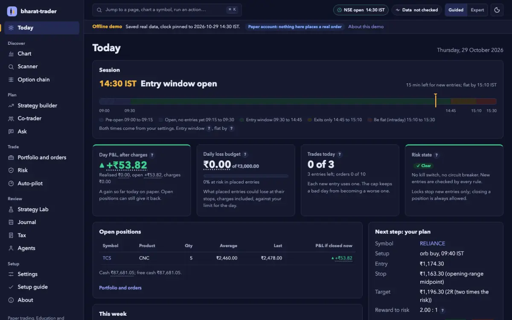
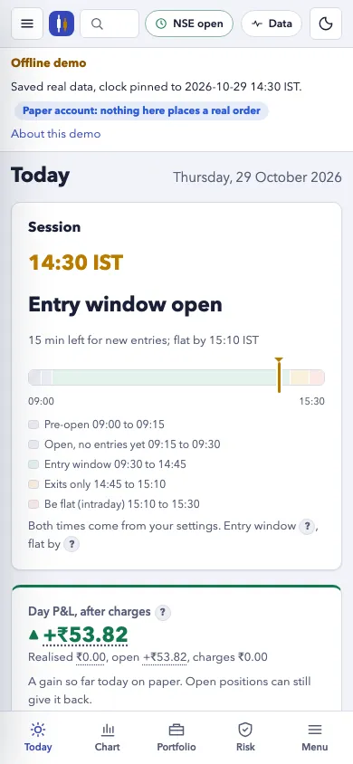

# The local web UI

A zero-install web app for the same tools you run in the terminal. Python
standard library only, nothing to build, nothing loaded from the internet.
Paper trading only: it cannot place a live order.


```bash
python3 ui/serve.py --open                         # http://127.0.0.1:8611/
python3 ui/serve.py --workdir ~/trading --port 9000
python3 ui/serve.py --offline tests/fixtures/ui --open
```

| option | meaning |
| --- | --- |
| `--workdir DIR` | The folder whose `trader/` files the UI reads and writes. Default: the current folder. |
| `--port N` | Default 8611. `0` picks a free port. |
| `--open` | Open the UI in your browser. |
| `--offline DIR` | Serve saved answers instead of the network (see below). |
| `--now "YYYY-MM-DD HH:MM"` | Pin the clock (IST), like the skills' `--now`. |
| `--host ADDR` | Default `127.0.0.1`. Anything else prints a warning: there is no login, so anyone who can reach the address sees your account. Prefer an SSH tunnel. |
| `--verbose` | Log every request. |

Ctrl-C stops the server cleanly.

## First run

On a folder with no `trader/config.json` the app opens the **setup guide**
(`#/welcome`), four skippable steps:

1. **Your account**: capital, risk per trade, trades per day, product (MIS or
   CNC) and broker (only for its square-off time). As you type, the guide shows
   the config `trader-budget/size.py init` would write and what it means in
   rupees (`GET /api/onboarding?capital=...`); **Save settings** sends it to the
   same validated `POST /api/config` the Settings page uses. `broker`, `paper`
   and `live_enabled` are never part of it: paper stays the default.
2. **AI assistant**: the MCP server entry for this folder, ready to copy (see
   [mcp.md](mcp.md)).
3. **Broker, read only**: which `BT_*` variables are set (names only) and the
   login command (see [brokers.md](brokers.md)).
4. **Done**: choose guided or expert detail.

"Skip setup for now" remembers the choice in this browser; the guide stays in
the menu (Setup guide).

## Layout and navigation

Pages are grouped by the trader's day, so each step's next step is close by
(the research and the design system are in [design.md](design.md)):

| group | pages |
| --- | --- |
| Today | the cockpit, the home page |
| Discover | Chart, Scanner, Option chain |
| Plan | Strategy builder, Co-trader (coming in v0.3) |
| Trade | Portfolio and orders, Risk, Auto-pilot (coming in v0.3) |
| Review | Strategy Lab, Journal (coming in v0.3), Agents |
| Setup | Settings, Setup guide, About |

- 1100 px and wider: the groups are a sidebar. Narrower: the menu button opens
  them as a drawer. Under 760 px a bottom bar holds Today, Chart, Portfolio,
  Risk and Menu. No page link is ever cut off (#39).
- **Ctrl K** (**⌘ K** on a Mac) or `/` opens the command palette: type a page,
  a symbol (`TCS` charts it) or an action (theme, detail level, data self-test).
- **Guided / Expert** in the top bar: guided shows a one-line meaning under key
  numbers and roomier type; expert is denser and hides them. A small **?** next
  to a term explains it in plain words.
- Gains and losses carry a sign and a ▲ or ▼, not only a colour; pass and block
  carry ✓ and ✕.
- The pages for Co-trader, Auto-pilot and Journal are placeholders, labelled
  "Coming in v0.3", that say what they will show.

## Pages

| page | shows | from |
| --- | --- | --- |
| Today | The session rail (pre-open to 15:30 IST with your entry window, exits-only time and flat-by, and a now needle), day P&L after charges (realised, open, charges), the daily loss budget used, trades used, risk state (kill switch, circuit-breakers), open positions, the plan and its last risk check, alerts, NSE status, indices, the data self-test, and places for the market regime and co-trader candidates (coming in v0.3) | `/api/dashboard`, `/api/portfolio`, `/api/risk` |
| Strategy Lab | Each trader-lab run: the verdict and why, out-of-sample trades (the sample size), expectancy after charges, the Monte Carlo range of the final P&L, max drawdown, the equity curve after charges with the out-of-sample windows shaded, the gates, results by regime, the deflated Sharpe ratio, the probability of overfitting, the paper forward test, and what a backtest does not show | `trader/lab/<name>/results.json`, `status.json`, `equity.csv` from `trader-lab/lab.py run` |
| Setup guide | The first-run steps above | trader-budget `build_config`, `describe_config`; the settings validator; trader-broker's adapters |
| Chart | Candles and volume at 1m, 5m or 1d; EMA 9 and 21; session VWAP; the opening-range band; the plan's entry, stop and target; trader-entry's breakout status | Yahoo bars through trader-scanner's `yahoo_get`, parsed and evaluated by trader-entry; `trader/plan.json` |
| Scanner | `trader/watchlist.json` with setups, RSI, turnover, and delayed quotes for the 10 most traded hits | trader-scanner; trader-alerts quotes |
| Portfolio | Paper cash, positions marked to a delayed price, P&L if closed now after charges, working stop/target legs, order tickets (an F&O basket as one ticket with one yes form), fills and the decisions log; the F&O book by strategy (marks, P&L, Greeks, margin blocked, payoff at expiry) with adjust and close buttons that only write a proposal; and, on a click, your real broker's holdings and positions (read only) | trader-broker `load_portfolio`, `apply_fill`, `side_charges`, `ticket_json`, `basket_view`, `mtm_view`, `ticket.py adjust`; the broker adapters' `holdings`, `positions` |
| Risk | The kill switch (on, with optional flatten; lifted only with the typed word `unkill`), the circuit-breakers, the F&O book's Greeks gauges against your limits and its scenario heatmap (spot +/-1/2/3 sigma x IV +/-5/10 vol, after charges), your limits, the verdicts trader-risk recorded, and a fresh preview (not recorded) | trader-risk `check`, `scenarios`, `kill`, `unkill` |
| Settings | The broker connection (which `BT_*` variables are set, never their values; token; `live_enabled`; the last preflight), then every `trader/config.json` key with its meaning from [configuration.md](configuration.md); validate and save | the skills' own parsers (see below); trader-broker's adapters |
| Option chain | The chain by expiry with ITM shading, OI bars, OI change, volume, our IV, a Greeks toggle; spot and forward, ATM IV, expected move, straddle, PCR, max pain, call and put walls; the IV smile and the max-pain curve; today's OI build-up | trader-options `fetch_*`, `analyse`, `smile`, `max_pain`, `oi_buildup`, `expiry_table` |
| Agents | The agent team (`agents/*.md`): each persona's role and description and its paper scorecard (closed trades, P&L after charges, profit factor, expectancy, drawdown, streaks, tickets drafted / confirmed / declined, flags for overtrading, revenge trades, late exits and off-ticket fills, recent trades); untagged trades and the Strategy Lab verdicts. Read only. See [agents.md](agents.md) | `ui/api.py` `persona_scorecards` over `trader/state/trades.json`, `broker.json` and `personas.json` |
| Strategy | Template picker or custom legs, a legs editor, the payoff chart (expiry and a chosen date, gross and after charges, spot, forward, breakevens, the 1-SD band), net Greeks, margin with its method and error, PoP textbook vs simulated with EV and 5% tail, IV-shift scenarios, charges, and Send to paper (a proposal) | trader-strategy `template_specs`, `parse_legs`, `resolve_legs`, `evaluate`, `write_orders` |

Click any number with a dotted underline for its **why** panel: the formula,
its inputs, the source and the time.

Keyboard: `Ctrl K` or `/` the palette; `g` then a letter jumps to a page:
`d` Today, `c` chart, `s` scanner, `o` option chain, `b` strategy, `k`
co-trader, `p` portfolio, `r` risk, `u` auto-pilot, `l` lab, `j` journal, `t`
agents, `e` settings, `w` setup guide, `a` about. `t` theme, `x` guided or
expert, `?` the list, `Esc` closes a panel. Dark and light themes follow your
system setting until you press the toggle.

## One implementation of every number

`ui/api.py` holds one table, `ROUTES`, mapping each route to a function that
calls the skill scripts. They are loaded straight from their folders, the same
way the tests load them, so the UI and the terminal can never disagree.
Another front end can import `ui/api.py` and call `dispatch()` the same way.

Two things are computed in the UI because no skill has them yet: the **EMA**
and the **session VWAP** drawn on the chart. Their why panels say so, and no
skill decides anything on them.

Live answers are cached briefly (quotes 15 s, NSE status 2 min, 1-minute bars
30 s, 5-minute bars 1 min, daily bars 15 min) so a page refresh does not hit the
free endpoints again.

### Routes

| method | path | does |
| --- | --- | --- |
| GET | `/api/meta` | version, workdir, offline mode, the clock, the route list |
| GET | `/api/status` | NSE status; `?verify=1` also asks nseindia.com |
| GET | `/api/dashboard` | market, indices, today's paper P&L, plan, alerts, risk summary (the Today page) |
| GET | `/api/indices` | NIFTY 50, BANK NIFTY, INDIA VIX |
| GET | `/api/quotes?symbols=A,B` | delayed quotes (up to 12 symbols) |
| GET | `/api/chart?symbol=&interval=1m\|5m\|1d&ema=9,21` | bars, overlays, opening range, plan levels |
| GET | `/api/scanner`, `/api/plan`, `/api/alerts` | the scanner, exit and alerts files |
| GET | `/api/portfolio`, `/api/orders`, `/api/risk`, `/api/config` | account, tickets, verdicts, settings |
| GET | `/api/fno` | the paper F&O book by strategy: marks, P&L, Greeks, margin, payoff at expiry |
| GET | `/api/options?symbol=&expiry=&strikes=` | trader-options' analysis of one expiry, the expiry list, why panels |
| GET | `/api/strategy` | the templates, symbols and the saved `trader/strategy.json` |
| GET | `/api/broker` | the live broker connection, no network: variables set (names only), capabilities, plans, last preflight |
| GET | `/api/broker/holdings?broker=`, `/api/broker/positions?broker=` | read only, from the broker's API (cached 30 s; never called offline) |
| GET | `/api/doctor` | the last data self-test from `trader/doctor.json` (the header's Data badge) |
| GET | `/api/agents` | the agent personas (`agents/`) and each one's paper scorecard, read only |
| GET | `/api/lab` | Strategy Lab runs from `trader/lab/`: verdict, after-charges numbers, gates, robustness, the equity curve (at most 400 points), why panels and what a backtest does not show |
| GET | `/api/onboarding` | the setup guide: the MCP entry for this folder, broker variables set (names only); with `?capital=&risk_pct=&max_trades=&product=&broker_profile=` the config `size.py init` would write, checked, without saving |
| GET | `/api/stream` | Server-Sent Events: `status`, `prices`, `alerts` |
| POST | `/api/risk/check` | `check.py`: record verdicts in `trader/state/risk.json` |
| POST | `/api/risk/kill` | `check.py kill`: `{"reason"?, "flatten"?}`; no new entries today, recorded entry PASSes revoked |
| POST | `/api/risk/unkill` | `check.py unkill`: `{"typed": "unkill"}`, word for word |
| POST | `/api/prices/refresh` | `alerts.py quote --holdings --write` |
| POST | `/api/orders/confirm` | `ticket.py confirm` with your typed reply |
| POST | `/api/orders/decline` | `ticket.py decline` |
| POST | `/api/orders/confirm` with `basket` | `ticket.py confirm --basket --basket-id ID`: one yes for every leg of the basket shown |
| POST | `/api/orders/fill` | `ticket.py fill` (paper; `basket`: every leg or none) |
| POST | `/api/fno/adjust` | `ticket.py adjust`: write a roll, close-leg, hedge or close-all PROPOSAL; places nothing |
| POST | `/api/config/validate` | check a config without saving |
| POST | `/api/config` | validate and save `trader/config.json` (the old one becomes `config.json.bak`) |
| POST | `/api/strategy/price` | price a template or custom legs (nothing is written) |
| POST | `/api/strategy/draft` | write the legs as a paper PROPOSAL to `trader/orders.json` and the strategy to `trader/strategy.json`; refuses other proposals unless `replace`, and a non-paper config |
| POST | `/api/doctor/run` | `doctor.py --json`: probe every data source now (about 30 s) and update `trader/doctor.json`; offline it replays `<offline>/doctor/` |

Send to paper never places anything: the proposal goes through Run risk check
and then one typed yes for the whole basket on the Portfolio page.
trader-risk blocks option legs unless `allow_fno` is on; with it on, it
checks the legs as one basket (lots, ban list, premium, margin, Greeks,
scenarios).
Payoff, smile and max-pain charts are drawn by `ui/static/js/plot.js` on a
canvas (no library, no inline styles).

The stream polls once for every open tab, only while a tab is open: every 15 s
while NSE is open, every 2 minutes when it is closed.

## It never places a live order

The only order writes are the paper broker's own commands. `confirm` runs
`ticket.py confirm`, which refuses anything trader-risk did not PASS today for
that exact order, refuses "ok", "sure", "yes to all" or a yes naming another
stock or amount, and records your words verbatim. With a live config
(`"paper": false`) the UI's confirm refuses: a live yes is typed in your own
terminal and the order is sent only by `ticket.py place` (see
[brokers](brokers.md)). The settings page cannot change `paper`, `broker` or
`live_enabled`: going live is your own edit of the file. The broker routes
only read.

## Settings validation

Before saving, the config is checked with the skills' own rules: number, true/
false and list types against the defaults; percentages 0 to 100; IST times with
trader-risk's parser; `extra_holidays` and `special_sessions` with
trader-alerts' calendar; blocked symbols with trader-risk's ticker rule;
charge rates as numbers; `no_entries_before` before `no_entries_after`; and
trader-broker's broker and paper rules (a live config gets a warning);
`live_enabled`, `static_ip` and `order_rate_per_sec` (at most 9). Keys no tool reads are kept, with a
warning. The plain-words summary comes from trader-budget.

## Security

A web page from any site can try to reach a server on your machine. So:

- the server binds `127.0.0.1` only (unless you say `--host`, with a warning);
- the `Host` header must name this server (`127.0.0.1:PORT` or
  `localhost:PORT`), which stops DNS-rebinding attacks;
- a browser `Origin` must be this server's own, and `Sec-Fetch-Site`, when the
  browser sends it, must be `same-origin`; there are no CORS headers, and `OPTIONS` is refused;
- every POST needs the session cookie (`HttpOnly; SameSite=Strict`) and its
  CSRF token in `X-CSRF-Token`, plus a JSON body under 256 KB;
- every response carries a strict Content-Security-Policy:
  `default-src 'none'; script-src 'self'; style-src 'self'` (plus the hash of
  the one stylesheet the chart library adds for its logo), `connect-src
  'self'`, `frame-ancestors 'none'`; also `nosniff`, `no-referrer` and
  `X-Frame-Options: DENY`;
- static files are served only from `ui/static/`, by a fixed list of types.

`tests/test_ui.py` checks each of these.

## Offline demo and fixtures

`--offline DIR` reads `DIR/yahoo-<SYMBOL>.json` (quotes),
`DIR/chart-<SYMBOL>-<interval>.json` (bars), `DIR/nse-marketStatus.json`, and
pins the clock to `DIR/offline.json`'s `"now"`. If `DIR` has a `trader/`
folder and you give no `--workdir`, a temporary copy is used and deleted when
you stop, so clicking through the demo never edits the fixtures.

`tests/fixtures/ui/` is such a folder: real Yahoo and NSE answers of 29 Oct
2026 (BANK NIFTY and INDIA VIX quotes from 30 Oct), with a `trader/` folder
built by running the skills on them, and `lab/` with two real Strategy Lab
runs (copied to the demo's `trader/lab/`). The clock is pinned to 14:30 IST so the
whole paper flow (risk check, typed yes, fill) can be tried.

## Screenshots

From `python3 ui/serve.py --offline tests/fixtures/ui` (saved data of 29 and
30 October 2026):

| | |
| --- | --- |
|  |  |
| Today, dark | Today on a phone |
|  |  |
| Strategy Lab | Setup guide |
|  |  |
| Chart | Option chain |
|  |  |
| Risk | Strategy builder |

Remake them after a UI change with the headless browser you already have
(Chrome, Chromium or Edge; set `BT_BROWSER` if it is not found):

```bash
python3 ui/screenshots.py                                  # every page at 1280, 1440 and 390 px -> ui-shots/
python3 ui/screenshots.py --pages today,lab --widths 1440 --theme dark
python3 ui/screenshots.py --fresh --pages welcome          # the setup guide on an empty folder
```

It drives the browser over its DevTools protocol (standard library only), so a
phone width is exactly 390 px, and flags any page that scrolls sideways or
shows an error. `tests/test_ui_screens.py` runs it on the key pages when a
browser is installed (skipped in CI unless `BT_UI_SCREENS=1`).

## Charts and licences

Candlesticks use [TradingView Lightweight Charts™](https://www.tradingview.com/lightweight-charts/)
5.2.1 (Apache-2.0), committed unmodified in `ui/static/vendor/` with its
`LICENSE`, `NOTICE` and SHA-256 (see `ui/static/vendor/README.md`). Its logo
stays on every chart as the attribution link, and the About page shows the
notice. Payoff, smile, max-pain and Greeks charts are our own canvas code
(`ui/static/js/plot.js`).
